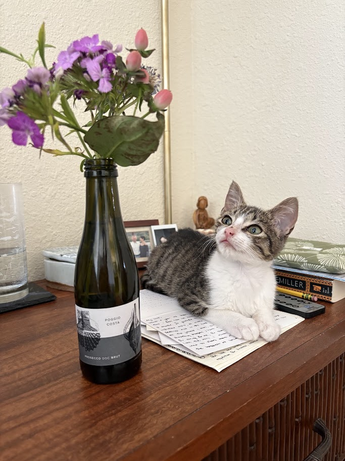
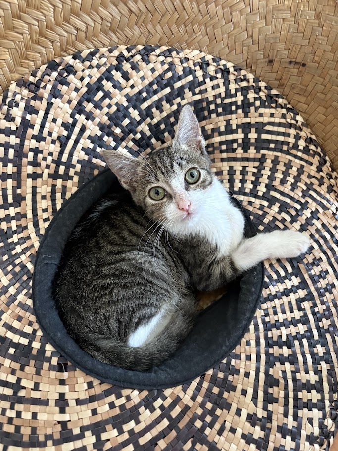
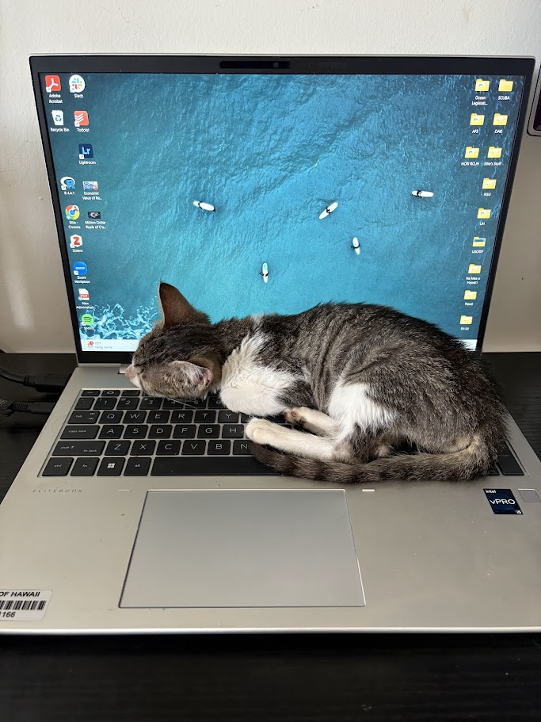

# Ellie S Jones

## My Quarto Links
##### Here is a list of my Quarto links for this class.
* [Good Plot/Bad Plot Assignment](https://01a1580f-7d67-d703-841f-cb3b2d2f1793.share.connect.posit.cloud/)  

* [Week 6 Homework](https://ellieoftheocean-ocn-682---ellie-s-jones---week-6-homework.share.connect.posit.cloud/)
* [Week 7 Homework](https://01a1376f-5355-fc91-3fb6-49092cdf63fb.share.connect.posit.cloud/)
* [Week 8 Homework](https://01a1583c-85f0-d8ab-2fc7-d2e0ecfe99d5.share.connect.posit.cloud/) 
* [Week 9 Homework](https://01a17f2f-f35b-8674-f54a-803e5eba8332.share.connect.posit.cloud/)

### My Research

I am a Masters student in the **Sustainable Fisheries Graduate Program** within SOEST. I am in Dr. Eileen Nalleyʻs lab, the Pacific Islands Coastal and Community Health Center of Excellence within University of Hawaiʻi Sea Grant.  
I will be studying how water quality relates to nearshore fisheries assemblages, especially species that are culturally and commercially important. This is a continuation of the work I have done with the Division of Aquatic Resources for the past three years.   
In addition to my Masters program, I will continue to serve as the Water Quality Coordinator for the Division of Aquatic Resources.

I am stoked about taking this course because I have always wanted to be more fluent in R, and I have noticed a need for more marine managers who are comfortable with coding, data management, and statistics. I hope to be one of those people!

### My cat

Normally, while doing homework at home, my cat likes to sit on my lap or desk and work with me, so I figured I should introduce him to you all here. His name is Prince and heʻs very tiny and soft.

### My interests

Outside of school, I love spending time in the ocean. When Iʻm not on a computer, youʻll usually find me diving, paddling, surfing, or just having a nice ocean float to de-stress.
