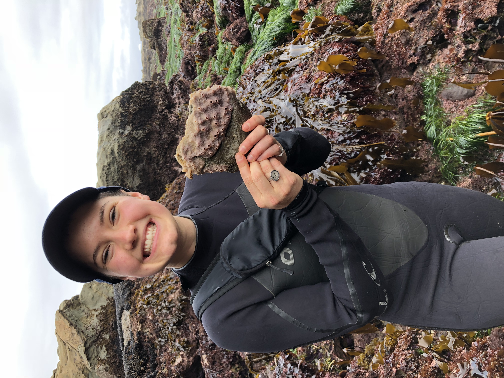

In this homework, we will read in files collected in tide pools in Oregon by Jenn Fields and calcuate the mean and standard deviation of temperature and light in each tide pool.

```{r}
## Load libraries
library(tidyverse)
library(here)
```

First, we will read in the datasets and create a for loop to calculate the mean and standard deviation of tide pool data. 
```{r}
## Read in all datasets from one file
TidepoolPath <- here("Week_13","Data","homework")               # Create a path to point to the folder on the computer holding the tidepool datasets
TidepoolFiles <- dir(path = TidepoolPath, pattern = ".csv")     # List .csv files in that path
TidepoolFiles
TidepoolPath
```

```{r}
## Pre-allocate space for the loop, creating one row for each file and five columns
TidepoolData <- tibble(filename = rep(NA, length(TidepoolFiles)),
                    mean_temp = rep(NA, length(TidepoolFiles)),
                    sd_temp = rep(NA, length(TidepoolFiles)),
                    mean_light = rep(NA, length(TidepoolFiles)),
                    sd_light = rep(NA, length(TidepoolFiles)))
TidepoolData
```

```{r}
## Write and test the basic code by reading in the first file
TidepoolRaw <- read_csv(paste0(TidepoolPath,"/",TidepoolFiles[1]))
head(TidepoolRaw)
mean_temp <- mean(TidepoolRaw$Temp.C,na.rm = TRUE)
mean_temp
```

```{r}
## Create the for loop!
for(i in seq_along(TidepoolFiles)){
  TidepoolRaw <- read_csv(paste0(TidepoolPath,"/",TidepoolFiles[i]))
  TidepoolData$filename[i] <- TidepoolFiles[i]
  TidepoolData$mean_temp[i] <- mean(TidepoolRaw$Temp.C,na.rm=TRUE)
  TidepoolData$sd_temp[i] <- sd(TidepoolRaw$Temp.C,na.rm=TRUE)
  TidepoolData$mean_light[i] <- mean(TidepoolRaw$Intensity.lux,na.rm=TRUE)
  TidepoolData$sd_light[i] <- sd(TidepoolRaw$Intensity.lux,na.rm=TRUE)
}
TidepoolData
```

Next, we will perform the same functions using tidyverse map functions in purrr instead of Base R for loops.
```{r}
## Bring in the four tide pool datasets for use in mapping
TPPath <- here("Week_13","Data","homework")
files <- dir(path = TPPath, pattern = ".csv", full.names = TRUE)
files
```

```{r}
## Read in all files as a single dataset
TPdata <- files |>                    # Create a name for the dataset
  set_names() |>
  map(read_csv) |>                    # Read in all of the data at once with map
  list_rbind(names_to = "filename")   # Add a column for the file name
TPdata                                # View a tibble of the data
```

Now, we will use maps and for loops in purrr to calculate the mean and standard deviation of temperature and light in the tide pools.

```{r}
## Calculate the mean and standard deviation for temperature in each tide pool
TPtemp <- files |> 
  set_names() |>
  map(read_csv) |> 
  list_rbind(names_to = "filename") |>
  group_by(filename) |>
  summarise(mean_temp = mean(Temp.C, na.rm = TRUE),  # Calculate the mean of temperature
            sd_temp = sd(Temp.C, na.rm = TRUE))      # Calculate the standard deviation of temperature
TPtemp
```
```{r}
## Calculate the mean and standard deviation for temperature in each tide pool
TPlight <- files |> 
  set_names() |>
  map(read_csv) |> 
  list_rbind(names_to = "filename") |>
  group_by(filename) |>
  summarise(mean_light = mean(Intensity.lux, na.rm = TRUE),   # Calculate the mean of light intensity
            sd_light = sd(Intensity.lux, na.rm = TRUE))       # Calculate the standard deviation of light intensity
TPlight
```
Now, we have data on the physical characteristics of the seawater in each tide pool! Yay!

Also, because the tide pools in Oregon are one of my favorite places in the whole world, please enjoy this photo of me in a tide pool with a purple sponge circa 2018. (I wore the wetsuit so I could crawl/sit/submerge myself in the tide pools with more ease.)

